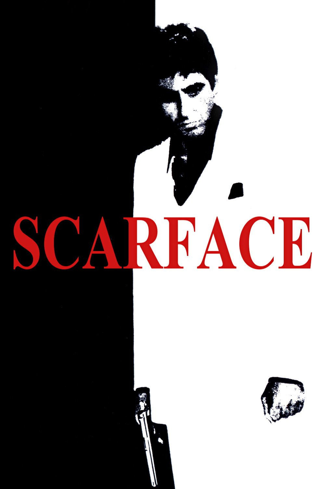

# CineVault 🎬 — Premium Cinema Archive

> **"The World Is Yours."**  
> CineVault is a sleek, dark-themed movie vault and cinematic catalog built with pure HTML5, CSS3, and vanilla JavaScript.



## ✨ Features

- **Main Attraction**: Headline showcase featuring Al Pacino in **Scarface** (1983) with widescreen backdrop, ratings, and YouTube trailer.
- **Telugu Masterpieces & Pawan Kalyan Cult Classics**:
  - *They Call Him OG* (2025, Pawan Kalyan)
  - *Kushi* (2001, Pawan Kalyan)
  - *Tholi Prema* (1998, Pawan Kalyan)
  - *Kalki 2898 AD*, *Baahubali 2: The Conclusion*, *Pushpa 2: The Rule*, *Salaar: Part 1 - Ceasefire*, *Devara: Part 1*
- **Ram Charan's Complete Filmography**:
  - *Peddi* (2025)
  - *Game Changer* (2025)
  - *RRR* (2022)
  - *Rangasthalam* (2018)
  - *Dhruva* (2016)
  - *Magadheera* (2009)
- **Clint Eastwood Cowboy Westerns**:
  - *The Good, the Bad and the Ugly* (1966)
  - *A Fistful of Dollars* (1964)
  - *Unforgiven* (1992)
- **Hollywood, Bollywood & World Cinema Legends**:
  - *Oppenheimer*, *Dune: Part Two*, *Interstellar*, *The Dark Knight*, *Inception*, *The Godfather*, *Gladiator II*
  - *3 Idiots*, *Dangal*, *Gangs of Wasseypur*, *Tumbbad*, *Andhadhun*, *Jawan*, *Stree 2*
  - *Parasite*, *Spirited Away*, *Seven Samurai*, *City of God*, *Pan's Labyrinth*, *Anatomy of a Fall*, *Oldboy*, *Godzilla Minus One*
- **Live Search & Multi-Filters**: Instant search by Title, Director, or Cast. Filter by Industry pills (*All*, *Telugu*, *Hollywood*, *Hindi*, *World Cinema*) and Genre (*Action*, *Drama*, *Western*, *Crime*, etc.).
- **Personal Watchlist**: Slide-out drawer saved in `localStorage` with counter badges.
- **TMDB v3 API Integration**: Seamless toggle between offline curated catalog and live TMDB database queries.
- **Embedded Video Player**: Pop-up YouTube trailer player with external fallback links.
- **Procedural SVG Fallbacks**: Built-in 2-stage fallback guarantees no broken images even offline.

## 🚀 Live Demo

- **Vercel Deployment**: [https://cinevault.vercel.app](https://cinevault.vercel.app)
- **GitHub Repository**: [https://github.com/27-mahidhar/cinevault](https://github.com/27-mahidhar/cinevault)

## 🛠 Local Setup

Clone and run directly with any static server:

```bash
git clone https://github.com/27-mahidhar/cinevault.git
cd cinevault
python3 -m http.server 8000
```
Open `http://localhost:8000/` in your browser.

---

Built for cinephiles with modern CSS grid, glassmorphism, and zero external build steps.
